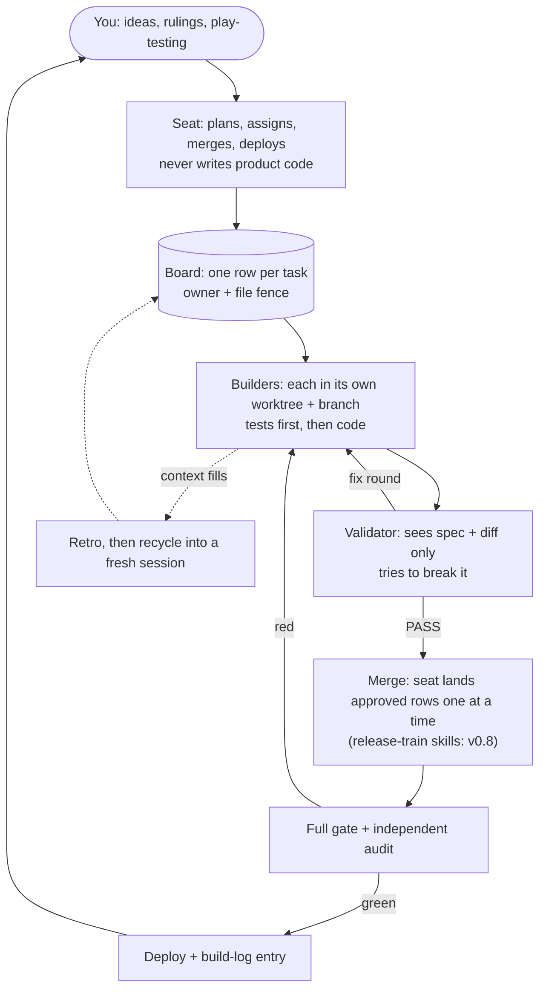

# How it all works

One human, one **seat** session and a few **sibling** sessions, all in one repo. The seat plans and merges and never writes product code; siblings build and check each other's work. This page shows the loop, then each piece: what it does, why it exists (the failure it prevents) and the knob you turn to change it.

**Pick your size:**

- **Solo (practice):** two terminals, no seat; you play the orchestrator by hand. You get worktrees, tests first and the independent check. Start at the first diagram and the *Make it your own flavor* section.
- **Two sessions:** one builder, one validator. Add the board and a brief per task.
- **A team:** a seat plus siblings, trains, the throttle and the guards. Everything below applies.

## The loop



You give ideas to the seat; the seat writes fenced rows on the board; builders work in private worktrees; validators check each finished row; the seat merges approved rows one at a time onto a train, runs the full gate and deploys. Dotted lines are the context loop: a full session writes down what it learned and is replaced.

## Why merges stay clean

Ten writers can share one codebase because six things never happen:

1. **Fences are disjoint.** Before a row is handed out the seat lists the files it may touch. Two rows running at once never share a file.
2. **Every session has its own copy.** Each builder works in a separate git worktree on its own branch, so nobody sweeps up another session's half-finished edit.
3. **One allocator for shared numbers.** Row ids, versions, build-log entries and the deploy slot are minted only by the seat. Siblings name their own discoveries with a per-session prefix.
4. **Check before merge.** A finished row goes to a different session that never saw the builder's reasoning, only the spec and the change. It tries to prove the change wrong.
5. **Merge one at a time.** The seat lands approved rows one by one (`skills/reconcile/SKILL.md`), re-proves the gate after each and pushes immediately.
6. **Tests come first.** Every row starts with a test that fails, then the code that makes it pass. A merge that breaks something shows up red in the gate before it ships.

With the train skills (`skills/assemble-train/SKILL.md`, `skills/audit-train/SKILL.md`) each merge is also rehearsed with a dry run (`git merge-tree`) onto a train branch first, and the finished train is audited independently.

## The pieces, one by one

Each piece has the same three parts.

### The seat, the board and one allocator

**What it does:** One session (the **seat**) plans, writes rows on a shared board (`docs/orchestration/AGENT_BOARD.md`), assigns them, merges and deploys. The board carries status, not narrative: who owns a row, which files are fenced, what state it is in.

**Why it exists:** Two sessions that each "take the highest id and add one" pick the same id. A single allocator makes shared numbers (row ids, versions, the deploy slot) collision-free by construction.

**The knob:** `team:` block in `templates/ORCHESTRATION.md` (`seat`, `prefix`, `siblings`; `terminal` picks how session windows open; `bash scripts/start-team.sh`), the board rules in `skills/board/SKILL.md`, the loop in `skills/orchestrate/SKILL.md`.

### Briefs and the lean start

**What it does:** The seat writes a row's contract to `docs/orchestration/briefs/<ROW>.md` (from `templates/briefs/_TEMPLATE.md`) and pushes it before assigning. The builder runs `/orchestration-kit:orient-brief <ROW>`: it loads only that brief and the board banner, then sends one READY line to the seat.

**Why it exists:** A chat summary decays, and a full orientation spends a context window before any work. A brief is the same contract for the builder and for the validator who reads it later.

**The knob:** `templates/briefs/_TEMPLATE.md`, `skills/orient-brief/SKILL.md`; the model and effort per row are `model` and `effort` in the team block (cheap model for mechanical rows, strong model for risky ones).

### Worktrees and fences

**What it does:** Every session edits in its own git worktree on its own branch; every row names the files it may touch (its fence). Changes are staged by explicit path, never `git add -A`.

**Why it exists:** One session's `git add -A` once swept another session's uncommitted edit into its own commit, and the history stopped answering "which row did this".

**The knob:** `worktrees` (`advised` | `enforced`) and `git_guard` (`off` | `on`) in the team block; the hooks `hooks/worktree-guard.sh` and `hooks/git-guard.sh`. Hooks are opt-in per repo through the `docs/orchestration/.kit-hooks` marker.

### Tests first, the gate and the throttle

**What it does:** Each row goes RED (a failing test) then GREEN, and one canonical gate command proves the whole tree. `scripts/gate-throttle.sh` runs heavy commands through N machine-wide slots plus one priority slot for release gates; quiet mode holds every new run while you use the machine.

**Why it exists:** Eight sessions each running the full suite flaked every run on load, and the reds stopped being signal. A queue with a fair order keeps the gate trustworthy.

**The knob:** `command:` in the Gate block of `templates/ORCHESTRATION.md`; `gate_slots` in the team block; `bash scripts/gate-throttle.sh <command>`; `bash scripts/quiet-mode.sh on|off|status`.

### Independent READ and falsify

**What it does:** A finished row goes to a validator: a session that never builds, gets the contract only (spec + diff + gate) and tries to falsify it. It says whether it DERIVED its verdict or only checked consistency. `falsify` then proves each new guard can fail, by running a deliberate mutant and watching it go red.

**Why it exists:** A test and the code written by the same mind can ratify the same wrong value, and a check that cannot fail is not a check.

**The knob:** the `Validator seat` block in `templates/ORCHESTRATION.md`; `skills/verify-feature/SKILL.md` (subagent fallback) with `agents/verifier.md`; `skills/falsify/SKILL.md`.

### Release trains and the deploy policy

**What it does:** The seat merges READ-PASS rows one at a time onto a train branch cut from main, rehearses each merge, runs one full gate, has the train audited independently, then deploys. Whether it deploys on its own once green or asks you first is a policy you choose (default: ask).

**Why it exists:** Merging in parallel hides conflicts until deploy day; deploying on an unaudited or red tree ships the failure to your users.

**The knob:** the `Deploy` block in `templates/ORCHESTRATION.md` (`vehicle`, `exclusivity`, `post-deploy`, and `deploy_policy: ask | auto-when-green`, default `ask`); `skills/reconcile/SKILL.md`; the train skills `skills/assemble-train/SKILL.md` (land approved rows one merge at a time) and `skills/audit-train/SKILL.md` (a validator's sweep of the finished train).

### Context guard, retro and recycle

**What it does:** Each session's real context fill is measured (`scripts/ctx-fill.py`, never bytes divided by four). With the guard on, a `CONTEXT GUARD:` line appears as a session nears its report mark and its hand-over mark. At the mark the session runs `/orchestration-kit:retro` (writes down what it learned), and the seat recycles it into a fresh session: in the same tab when that tab runs the kit's `scripts/sibling-shell.sh` wrapper (every tab `start-team.sh` opens does), otherwise in a new window. Auto-compact stays off.

**Why it exists:** A session that runs into its window wall degrades silently: it re-reads files, loses SHAs and fences, and nobody notices until the damage is merged.

**The knob:** `ctx_guard` (`off` | `on`) and `context_window` (`1m` | `200k`) in the team block; `hooks/ctx-guard.py`, `scripts/recycle-sibling.sh`, `scripts/sibling-shell.sh`, `skills/retro/SKILL.md`. Marks: 350K report / 400K hand over on a 1M window; 120K / 150K on 200K.

**If a recycle is refused:** `scripts/recycle-sibling.sh` exits 3 when the old session still has a live background shell (a gate run, a loop). It looks twice, `LAUNCH_LIVE_RECHECK` seconds apart (default 1.5), and counts a shell only if the same process (same id and start time) is there both times, so the short-lived shell Claude Code runs for its status line does not block an idle session. Set `LAUNCH_LIVE_RECHECK=3` in front of the command only if an idle session is refused over a shell that is gone a moment later; otherwise leave it alone, because real work lives far longer than the gap. `--force` recycles anyway.

### Multi-account and the session cap

**What it does:** Optional: one team can use several Claude Code accounts (a config directory per account, `--account N` on the launch scripts). You also pick a cap on concurrent sessions that your machine can carry, and relaunch one session at a time after a crash.

**Why it exists:** Usage limits are per account, and memory is per machine: too many sessions together once exhausted a host and took every session down at once.

**The knob:** `docs/MULTI-ACCOUNT.md`, `--account` on `scripts/start-team.sh` and `scripts/recycle-sibling.sh`, `siblings` and `max_sessions` in the team block (unset = no check; the launch scripts warn before one more session would pass it).

### Non-blocking questions

**What it does:** The seat never freezes on a question for you. It asks in plain text (plus a push notification if you have one), keeps moving everything that does not depend on the answer, holds open questions as one queue line on the board banner, and re-presents them when you next type. A permission request arrives as one copy-pastable shell command, never a prose "please approve".

**Why it exists:** A blocking prompt has no timeout: one unanswered question would freeze every session behind it.

**The knob:** `questions: blocking | non-blocking` in `templates/ORCHESTRATION.md` and the loop in `skills/orchestrate/SKILL.md`. Change it any time: just ask Claude.

### The status HUD (optional)

**What it does:** A Claude Code mod that shows, in a band above your prompt and in a pane, each session's context fill, model and activity. `kit-init` asks whether to install it; the default is no.

**Why it exists:** From one terminal you cannot see ten sessions' fill; the HUD puts the report and hand-over marks where you can see them.

**The knob:** the HUD's README under `plugins/status-hud/`, the `kit-init` question, `/hud band|pane|off|quiet` while running, and `claude plugin configure status-hud@artekka-kits --values-stdin` for `showForNames` (the seat name it highlights) and the `quietMode*` keys. A lighter option with no mod is the statusline script `scripts/statusline-ctx.sh`. Change it any time: just ask Claude.

**What the WORK/QUIET chip does and when you'll see it:** The chip is a switch for the kit's quiet mode. QUIET holds every NEW test/gate run started through `scripts/gate-throttle.sh` while you use the machine yourself; runs already going finish, and WORK lets new ones start normally. It only helps if your team runs its gate through that throttle, so the chip appears only when `scripts/quiet-mode.sh` exists in the session's directory (or quiet mode is already on). No throttle, no chip. If a press fails, the chip turns red and says `failed` for a minute, and the toast says why. `/hud help` repeats this, and `quietModeRequiresFile` changes the file it looks for (empty always shows the chip).

## Make it your own flavor

Nothing in the kit is sacred. This is the order to tune things, what to drop when you are small, and how to add your own.

### What to tune first

| Knob | Where | Start with |
|---|---|---|
| The gate command | `command:` in the Gate block | Your real test command; add a fast path for RED proofs and a slow path for pre-deploy |
| Throttle slots | `gate_slots` | 2; lower it if gates flake under load, raise it on a big machine |
| Permission mode | `permission_mode` | `normal` (asks before risky actions); move to `accept-edits` or `auto` only once the guards are on; `bypass-available` adds bypass to Shift+Tab without starting in it |
| Model per lane | `model` / `effort` | Strong model for risky rows and every READ, a cheaper one for mechanical rows |
| Deploy policy | the `Deploy` block + `deploy_policy` | Ask first, until you trust the gate |
| Question mode | `questions:` in `templates/ORCHESTRATION.md` | Non-blocking: keeps the team moving while you are away |
| Session cap | `max_sessions` + `siblings` | Start at 3 to 4 on a laptop, and measure memory before raising it |

### What is safe to drop

| Your setup | Safe to drop | Keep |
|---|---|---|
| Solo practice (two terminals) | the seat, the validator seat, the throttle (`gate_slots`), `ctx_guard`, multi-account, trains | own worktree, tests first, a second session that reads the diff cold |
| Two sessions | trains and the deploy policy, quiet mode, multi-account, the HUD | the board, one brief per task, worktrees, the READ |
| A team | nothing is dead weight; drop the HUD and multi-account if you do not use them | everything else, because each piece prevents a failure that appears at about three sessions |

### Add your own rule, skill or hook

The kit way to add a rule has three steps and one test. Worked example: **"never push straight to main"**, enforced by an opt-in hook.

1. **Write the rule where every session reads it.** One line under `Locked` in `docs/orchestration/ORCHESTRATION.md`, mirrored in your `CLAUDE.md` (`templates/CLAUDE-section.md` shows the shape): *"Never push to `main`; push a branch and open a pull request."*
2. **Add the hook, opt-in.** Save the script below as `.claude/hooks/no-push-main.sh`. It does nothing unless the repo carries the `docs/orchestration/.kit-hooks` marker, exactly like `hooks/git-guard.sh`.
3. **Register it.** The kit's own hooks register themselves; yours needs one entry under `PreToolUse` in your project's `.claude/settings.json` (merge it with what is there). To turn it off, delete the marker or the entry, or just ask Claude.

```bash
#!/usr/bin/env bash
# .claude/hooks/no-push-main.sh: PreToolUse(Bash). Opt-in: a no-op without the .kit-hooks marker.
input="$(cat)"
main="$(git worktree list --porcelain 2>/dev/null | sed -n '1s/^worktree //p')"
[ -f "$main/docs/orchestration/.kit-hooks" ] || exit 0
cur="$(git symbolic-ref --short -q HEAD 2>/dev/null)"
verdict="$(printf '%s' "$input" | CUR="$cur" awk '
  { s = s $0 }
  END {
    # the command string of the tool call, JSON-unescaped (a newline becomes a separator)
    if (!match(s, /"command"[ \t]*:[ \t]*"/)) exit
    s = substr(s, RSTART + RLENGTH); out = ""; i = 1
    while (i <= length(s)) {
      c = substr(s, i, 1)
      if (c == "\\") { n = substr(s, i + 1, 1); out = out (n == "n" ? " ; " : n); i += 2; continue }
      if (c == "\"") break
      out = out c; i++
    }
    # split into simple commands on ; & | outside quotes, then judge each one on its own
    q = ""; seg = ""
    for (i = 1; i <= length(out) + 1; i++) {
      c = substr(out, i, 1)
      if (q == "" && (c == ";" || c == "&" || c == "|" || c == "")) { judge(seg); seg = ""; continue }
      if (q == "" && (c == "\"" || c == "\047")) q = c
      else if (q != "" && c == q) q = ""
      seg = seg c
    }
  }
  function judge(cmd,   n, w, k, pos, t, d) {
    gsub(/["\047]/, "", cmd); n = split(cmd, w, /[ \t]+/); k = 1
    while (k <= n && w[k] == "") k++
    if (w[k] != "git" || w[k + 1] != "push") return
    pos = 0
    for (k += 2; k <= n; k++) {
      t = w[k]
      if (t == "" || substr(t, 1, 1) == "-") continue          # options
      if (++pos == 1) continue                                # the remote
      d = t; if (d == "HEAD") d = ENVIRON["CUR"]            # bare HEAD pushes the current branch
       sub(/^\+/, "", d); sub(/^.*:/, "", d); sub(/^refs\/heads\//, "", d)
      if (d == "main") print "deny"                           # main, +main, HEAD:main, HEAD:refs/heads/main, :main
    }
    if (pos < 2 && ENVIRON["CUR"] == "main") print "deny"     # no refspec: pushes the current branch
  }
')"
[ -n "$verdict" ] && printf '%s\n' '{"hookSpecificOutput":{"hookEventName":"PreToolUse","permissionDecision":"deny","permissionDecisionReason":"Blocked: push a branch and open a pull request instead of pushing to main."}}'
exit 0
```

Registration entry for `.claude/settings.json`:

```json
{ "hooks": { "PreToolUse": [ { "matcher": "Bash",
  "hooks": [ { "type": "command", "command": "bash .claude/hooks/no-push-main.sh" } ] } ] } }
```

What it does **not** catch: `git -C <dir> push`, aliases, scripts that push, a `FOO=1 git push` env prefix, `sudo git push`, a subshell or `bash -c "git push …"`, a `--repo=` remote, and `git push <remote>` from a branch whose upstream is `main`. A quoted `;` or `&&` is respected, so a commit message that merely mentions the phrase is not blocked. Like `hooks/git-guard.sh`, it is a speed bump for an agent, not a sandbox.

Then prove it can fail, the kit way: run the hook with a push to `main` (it must deny) and with a push to a feature branch (it must stay silent), as `skills/falsify/SKILL.md` describes. Skills and rules follow the same pattern: write the rule, make it opt-in, prove it red.

## The honest version

- **"Without conflict" means "without surprises".** When two rows must touch the same file, the conflict shows up when the second one is merged and the seat settles it by a written rule. What never happens is a session silently overwriting someone else's work.
- **There is a cap.** Your machine's memory sets how many sessions can run at once. A session that runs low on context writes down what it learned and restarts fresh; the board and the build log carry everything forward.
- **Every knob is changeable.** Nothing here is fixed: ask Claude to change any setting, any time.

With the train skills the dry-run merge shows such a conflict ahead of time, before anything is merged.

## Where to go next

- [Getting started: your first hour](docs/GETTING-STARTED.md)
- [Glossary](docs/GLOSSARY.md)
- [Lessons: the incidents behind the rules](docs/LESSONS.md)
- [Multi-account setup](docs/MULTI-ACCOUNT.md)
- [An annotated 12-hour session](docs/EXAMPLE-SESSION.md)
